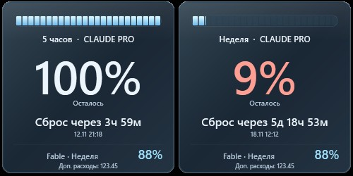
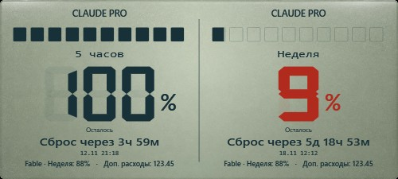
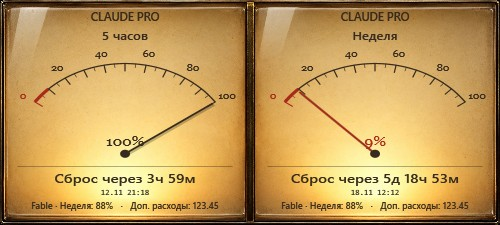
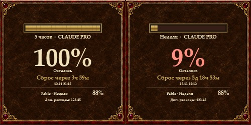
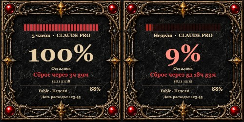

# ClaudeMeter

**Лимиты вашего тарифа Claude на рабочем столе Windows и в трее.** / Your Claude plan limits on the Windows desktop and in the tray.



> На скриншотах — демонстрационные значения, не реальные данные. / Screenshots show demo values, not real data.

## Возможности

- Остаток за **5 часов** (сессия) и за **неделю**, время до сброса (в местном времени компьютера).
- Недельный лимит по модели (например, Fable) и дополнительные расходы сверх подписки.
- Значок в трее с числом остатка. **Правый клик по значку → «Показывать лимит»** — выбрать, что показывать: 5 часов, неделю или авто. Выбор запоминается.
- 16 скинов, свои скины ([SkinGuide.md](SkinGuide.md)), 8 языков, автообновление.
- Прозрачность, размер колесом мыши, «поверх окон», автозапуск с Windows.

## Скачать

Последняя версия: [**Releases → Latest**](../../releases/latest).

| Файл | Что это |
|---|---|
| `ClaudeMeter-1.0.1-Lite-Setup.exe` | Установщик |
| `ClaudeMeter-1.0.1-Lite-Portable.zip` | Портативная версия: распаковать и запустить `ClaudeMeter.exe` |
| `SHA256SUMS.txt` | Контрольные суммы |

Требуется Windows 10/11 и [Claude Code](https://code.claude.com/docs/en/setup) с входом через аккаунт Claude (Pro, Max или Team). Вход через Console/API не имеет лимитов тарифа.

## Скины

| | |
|---|---|
|  |  |
|  |  |

Компактный вид (выбран один лимит): 

## Откуда берутся данные

1. Программа читает токен доступа из `%USERPROFILE%\.claude\.credentials.json`, который создаёт Claude Code.
2. Раз в две минуты отправляет один запрос на `https://api.anthropic.com/api/oauth/usage`.

ClaudeMeter **никогда не пишет, не обновляет и не копирует** файл входа, не делает запросов к модели (лимиты не тратятся) и не обращается никуда, кроме Anthropic (лимиты) и GitHub (обновления). Когда токен истёк, виджет сообщает об этом: откройте Claude Code (**Настройки → Открыть Claude Code…**), он сам обновит вход.

Адрес `oauth/usage` не входит в документированный API Anthropic. Если формат изменится, виджет покажет, что данные недоступны, до выхода обновления.

## English

ClaudeMeter shows your Claude plan usage: remaining quota for the 5-hour session and the week, time until reset, the per-model weekly limit, and extra usage beyond the plan. Right-click the tray icon → **Show limit** to choose 5 hours, week, or auto. It reads the token Claude Code stores in `~/.claude/.credentials.json` (read-only) and calls `api.anthropic.com/api/oauth/usage` every two minutes. Download the installer or portable ZIP from the [latest release](../../releases/latest). It is a port of [CodexMeter](https://github.com/AlexDM777/codex-meter).

## Сборка / Build

Windows, только .NET Framework из состава системы.

```powershell
powershell -ExecutionPolicy Bypass -File source\build.ps1
.\ClaudeMeter.exe --self-test
.\ClaudeMeter.exe --smoke
```

`--self-test` проверяет разбор записанного ответа. `--smoke` делает один реальный запрос с вашим входом (значения не сохраняются). Релиз: `release.ps1`, см. [RELEASING.md](RELEASING.md).

## Лицензии

Сторонние компоненты — [ThirdParty.txt](ThirdParty.txt), WebP — [WebP-LICENSE.txt](WebP-LICENSE.txt).
